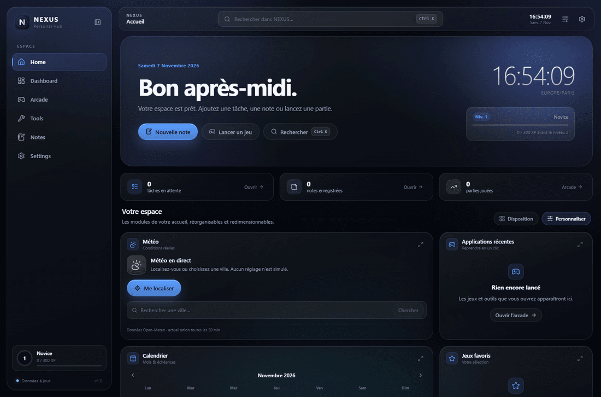
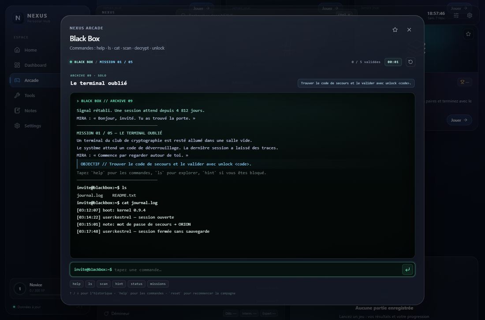

# NEXUS — Personal Hub

Un espace numérique personnel inspiré de l’écosystème Apple et du langage visuel « Liquid Glass ».
NEXUS réunit un tableau de bord, une salle d’arcade, des outils du quotidien et un espace de notes
dans une seule application locale, rapide et installable.

**En ligne : [https://louskyfly.github.io/nexus-personal-hub/](https://louskyfly.github.io/nexus-personal-hub/)**
· **Dépôt : [github.com/louskyfly/nexus-personal-hub](https://github.com/louskyfly/nexus-personal-hub)**



## Démarrer

```bash
npm install
npm run dev
```

Puis ouvrir l’adresse affichée par Vite (par défaut `http://localhost:5173`).

### Version de production

```bash
npm run build
npm run preview
```

Le build génère également le manifeste PWA, le service worker et les ressources hors ligne.

### Déploiement GitHub Pages

Le dépôt contient le workflow `.github/workflows/deploy.yml`. Chaque push sur `main` construit
l’application et la publie sur GitHub Pages. Le `base` Vite est calculé automatiquement à partir
du nom du dépôt lorsque le build tourne dans GitHub Actions.

## Fonctionnalités

### Accueil et Pocket Dashboard
- Accueil personnalisable : météo réelle, calendrier, tâches, notes rapides, applications récentes,
  jeux favoris et statistiques personnelles.
- Dashboard de 12 widgets autonomes : calculatrice scientifique, chronomètre, minuteur,
  compte à rebours, horloge mondiale, calendrier, tâches, notes rapides, liens favoris,
  bloc-notes multi-documents, convertisseur d’unités et générateur de nombres aléatoires.
- Chaque widget peut être agrandi, déplacé, redimensionné ou masqué. La disposition est conservée.

### Arcade
- **Snake**, **2048**, **Démineur**, **Pong**, **Morpion**, **Memory**, **Réflexes**
  et **Black Box**, le terminal narratif solo.
- **Black Box** : cinq missions, exploration de fichiers, réseau fictif, Base64,
  chiffrement de César, fichiers cachés et campagne sauvegardée.
- Records personnels, favoris, historique des parties, statistiques globales, XP,
  niveaux et 20 succès.
- Difficulté réglable pour Pong et Démineur, niveaux pour Memory, IA experte ou amicale au Morpion.
- Commandes clavier, souris et tactiles (dont le D-pad mobile pour Snake).



### Outils
- Générateur de mots de passe fictifs (jamais enregistrés).
- Générateur de QR codes téléchargeables.
- Roue aléatoire personnalisable et persistante.
- Générateur de palettes HEX/RGB/HSL avec conversion.
- Pipette de couleurs sur image importée, 100 % local.
- Convertisseur d’unités, de bases numériques et de formats texte (Base64, URL).
- Générateur de nombres, dés et pile ou face.
- Calculateur d’intervalles et de dates.

### Notes
- Création, édition et sauvegarde automatique.
- Catégories, recherche instantanée, épinglage.
- Corbeille avec restauration et suppression définitive.
- Navigation responsive liste/éditeur sur mobile.

### Paramètres et données
- Thèmes Midnight, Graphite et Frost, six couleurs d’accent.
- Animations, mode discret, sons synthétisés et raccourcis activables.
- Export/import complet en JSON.
- Stockage du contenu dans IndexedDB et des préférences dans localStorage.
- Installation PWA et fonctionnement hors ligne (hors météo).

## Raccourcis

| Raccourci | Action |
| --- | --- |
| `Ctrl/⌘ + K` | Recherche globale |
| `Ctrl/⌘ + B` | Replier/déployer la barre latérale |
| `Alt + 1…6` | Naviguer entre les sections |
| `Échap` | Fermer la fenêtre active |

## Technologies

- **React 19** + **Vite 8**
- **lucide-react** pour les icônes
- **qrcode** pour la génération de QR codes
- **vite-plugin-pwa** / Workbox pour le manifeste, le service worker et le cache hors ligne
- CSS natif avec variables de thème, `backdrop-filter` et animations respectant
  `prefers-reduced-motion`
- **sharp** (dev) pour générer les icônes PWA

## Données et confidentialité

Aucun serveur NEXUS n’est utilisé. Les notes, tâches, documents, statistiques et préférences restent
sur l’appareil. La météo est la seule fonction réseau : elle interroge Open-Meteo (géocodage et
prévisions) et affiche un état hors ligne ou des données en cache le cas échéant.

## Structure

```
src/
  components/   layout, modales, widgets partagés, palette de recherche
  games/        jeux et campagne Black Box dans src/games
  lib/          logique pure : stockage, calculs, unités, couleurs, sons, météo
  pages/        Accueil, Dashboard, Arcade, Outils, Notes, Paramètres
  state/        contextes React (données, préférences, navigation)
  styles/       feuilles CSS modulaires et thèmes
  tools/        les 8 outils
  widgets/      les widgets d’accueil et de dashboard
public/         icônes, favicon, manifeste
scripts/        génération des icônes
```

## Scripts

```bash
npm run dev      # serveur de développement
npm run build    # build de production avec PWA
npm run preview  # prévisualiser le build
npm run icons    # régénérer les icônes PWA
```
